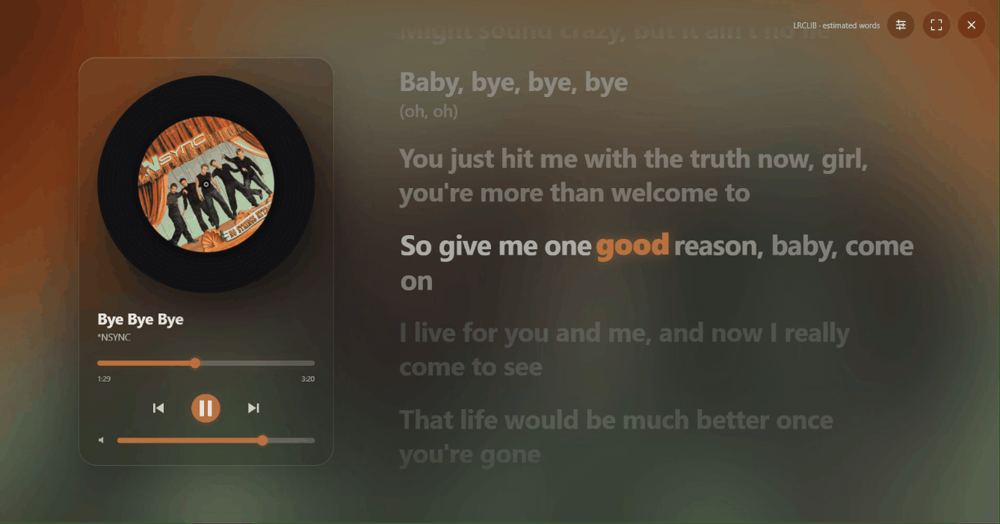
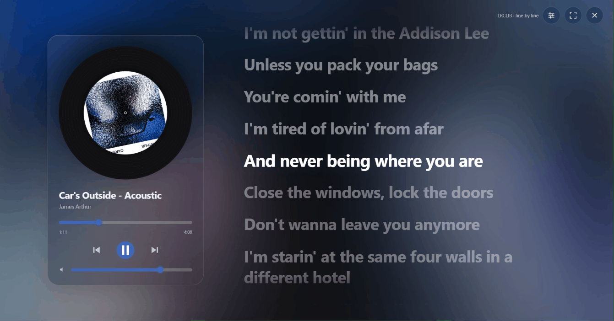
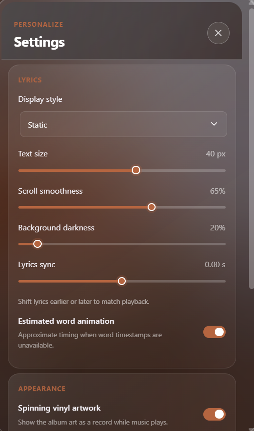

# Luma Lyrics v1.1.1

  
See the [public releases](https://github.com/Shahisha1/Luma-Lyrics/releases) to download Luma Lyrics.

Luma Lyrics adds synchronized lyrics and a full-window music player to Spotify desktop through [Spicetify](https://spicetify.app).


## Display modes

Luma Lyrics offers several ways to follow lyrics. These screenshots show each mode in action.

### Word by word



### Line by line



### Gentle


### Static


### Settings



## Features

- Synchronized lyrics with word-by-word highlighting for Enhanced LRC and inline timestamp formats.
- Slightly larger main lyric text, with bracketed ad-libs and secondary lyrics shown beneath in a smaller size.
- Word-by-word highlighting, with estimated timing enabled by default when only line timings are available.
- Choose word-by-word, line-by-line, gentle, or static lyric display.
- Tune lyric-scroll smoothness or turn it off for instant movement. Loading placeholders appear while lyrics are fetched.
- Adjust lyric timing earlier or later to compensate for a slightly offset lyric source.
- Import Enhanced LRC files for word-level timing. Imported files stay on your device.
- Built-in playback, volume, and seek controls.
- Material-style playback, seek, and volume controls with artwork-matched accents.
- Optional spinning-vinyl artwork and adjustable lyric size and background.
- Liquid-glass player and settings panels with clear Material-style surfaces, using accent colors sampled from the current album art.
- Reset all appearance and lyric preferences to their defaults from Settings.
- Optional desktop colors.
- Reduced-motion support.

## Install

1. Download `luma-lyrics.js` from the [latest public release](https://github.com/Shahisha1/Luma-Lyrics/releases/latest).
2. Copy it to your Spicetify extensions folder. On Windows, this is `%APPDATA%\spicetify\Extensions`.
3. Enable the extension and apply the change:

   ```bash
   spicetify config extensions luma-lyrics.js
   spicetify apply
   ```

4. In Spotify, select the Luma Lyrics button beside the playback controls. Use the settings button to customize the display.

## Lyrics and word timing

Lyrics are looked up through [LRCLIB](https://lrclib.net). Available line timings are synchronized with playback. Use **Lyrics sync adjustment** in Settings if a lyric source is slightly early or late; negative shifts lyrics earlier and positive shifts them later.

For timed word highlighting, create or export an Enhanced LRC file with [QuickLRC's Enhanced LRC guide](https://www.quicklrc.com/subtitle-formats/enhanced-lrc), then choose **Import LRC** in Luma Lyrics Settings. Luma Lyrics reads inline word timestamps from the imported file (including angle-bracket timestamps such as `[00:15.20]<00:15.20>Hello <00:15.70>world`). A file with only line timestamps will use estimated word highlighting instead. Imported files stay on your device; Luma Lyrics does not fetch lyrics from QuickLRC.

## Privacy

- To find lyrics, Luma Lyrics sends the song title, artist, album, and duration to LRCLIB.
- Imported LRC files stay on your device and are not uploaded.
- The extension does not send your Spotify token to LRCLIB.
- Appearance settings are saved in Spotify on your device.

## Troubleshooting and feedback

Spotify or Spicetify updates and other themes may affect how the extension works. Report problems or request a feature on the [Issues page](https://github.com/Shahisha1/Luma-Lyrics/issues). Include your Spotify and Spicetify versions when reporting a problem.

## References and inspiration

- [Liquid Lyrics](https://github.com/NMWplays/Liquid-Lyrics) — inspiration for the lyric experience and smooth word-by-word presentation. Luma Lyrics is an independent implementation and does not use Liquid Lyrics as a dependency.
- [QuickLRC Enhanced LRC guide](https://www.quicklrc.com/subtitle-formats/enhanced-lrc) — reference for importing Enhanced LRC files with inline word timestamps.
- [LRCLIB](https://lrclib.net) — lyric lookup service used by the extension.
- [Spicetify](https://spicetify.app) — platform and extension environment Luma Lyrics is built for.

## License

Luma Lyrics is available under the [MIT License](LICENSE). Lyrics, album artwork, and third-party services remain subject to their respective owners' terms.

Luma Lyrics is not affiliated with Spotify, Spicetify, or LRCLIB.
