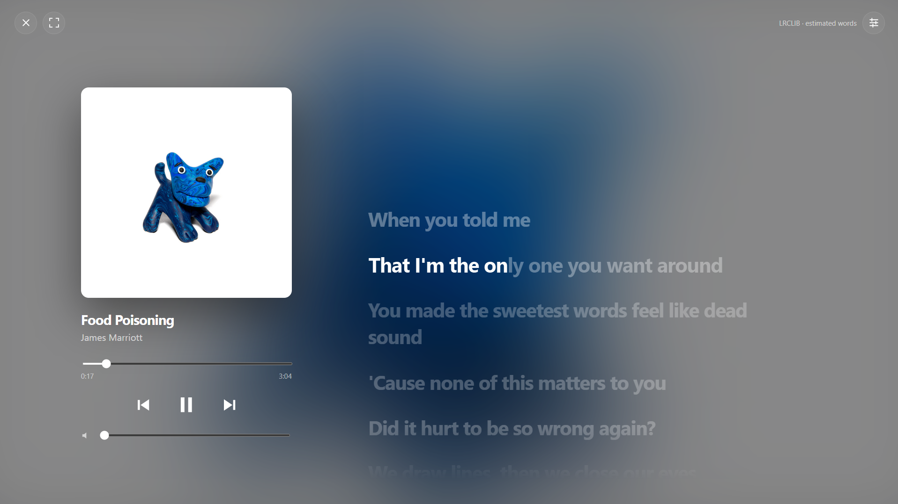

# Luma Lyrics (Beta)


An independent [Spicetify](https://spicetify.app) extension that turns Spotify's desktop player into an immersive two-column view: large artwork on one side and line-synced lyrics on the other. No Liquid Lyrics dependency.



## Features

- **Immersive player:** a fullscreen artwork and lyrics view with SVG controls, progress bar, and volume.
- **Line-synced lyrics:** timed lyrics from [LRCLIB](https://lrclib.net), with a plain-text fallback.
- **Enhanced LRC import:** load a local file to get word-level timing.
- **Click to seek:** click any lyric line to jump to it. Scrolling manually pauses auto-centering briefly.
- **Settings panel:** lyric size, background darkness, estimated word animation, and desktop colors.
- **Optional desktop recoloring:** Apple-inspired colors, opt-in only.
- **Discreet entry point:** a small icon beside Spotify's playback extra controls, with no floating button.
- **Accessibility:** respects the reduced-motion preference for line transitions and scrolling.

## Status

Version `0.2.0-beta.1`. This is a beta release, so you may run into bugs, and Spotify or Spicetify updates can break it. If something doesn't work, please open an issue.

## Installation

1. Copy `luma-lyrics.js` to your Spicetify extensions folder (on Windows: `%APPDATA%\spicetify\Extensions`).
2. Enable it and apply:

```bash
   spicetify config extensions luma-lyrics.js
   spicetify apply
```

3. Click the Luma Lyrics icon near the queue / lyrics / Now Playing controls. Use the settings icon to configure appearance.

> Don't enable the old `apple-room.js` at the same time. Shuffle is separate and untouched.

## Uninstall

```bash
spicetify config extensions luma-lyrics.js-
spicetify apply
```

Settings stay in `localStorage` until you clear them separately.

## Word timing

Automatic LRCLIB lookups don't include verified word timestamps.

- **Estimated word animation** is off by default and clearly labeled. It splits time between lyric lines by character count, so it won't accurately follow the singing.
- **For real word timing**, import an Enhanced LRC file with `mm:ss.xx` word-start tags. Fill is interpolated between word starts, and the last word uses the next line's timing or an explicit end tag.
- Not included: automatic word-timing providers, syllable alignment, translation, and romanization.

## Privacy and network use

- When opened, the extension sends the track's title, artist, album, and duration to `https://lrclib.net/api/get`. LRCLIB can see normal connection metadata such as your IP.
- No Spotify token is sent by this code.
- Requests are serialized and spaced at least 500 ms apart, with a 15-second timeout and a rate-limit cooldown.
- Lyrics (50 records) and imported files (30 tracks) are cached in memory until Spotify restarts.
- Imported files are read locally and never uploaded.
- Appearance settings are stored in `localStorage`.

## Known limitations

- Spotify or Spicetify updates may break APIs or theme selectors.
- Other themes may conflict with the extension.
- Artwork and lyrics depend on available metadata, and LRCLIB matches aren't guaranteed.
- No mobile support and no bundled ad blocker.

## Contributing

Issues and pull requests are welcome. When reporting a bug, include your Spotify version, Spicetify version, and active theme.

## Changelog

See [CHANGELOG.md](CHANGELOG.md).

## License

[MIT](LICENSE). The license covers this original code only, not third-party lyric text, artwork, Spotify assets, or any provider's rights.

## Disclaimer

Independent project, not affiliated with Apple, Spotify, LRCLIB, or Liquid Lyrics.

## References

- [LRCLIB API docs](https://lrclib.net/docs)
- [Spicetify Playbar API](https://spicetify.app/docs/development/api-wrapper/classes/playbar)
- [Spicetify Player API](https://spicetify.app/docs/development/api-wrapper/methods/player)
