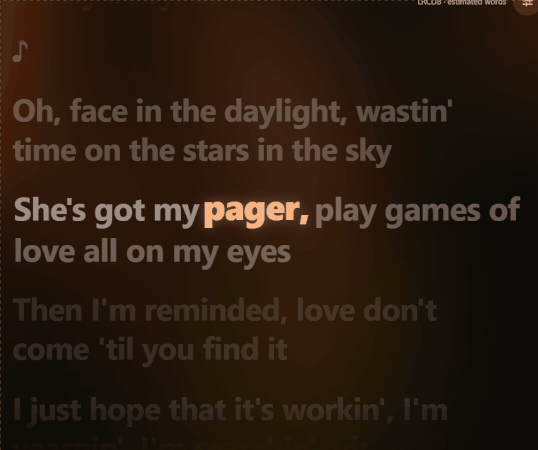
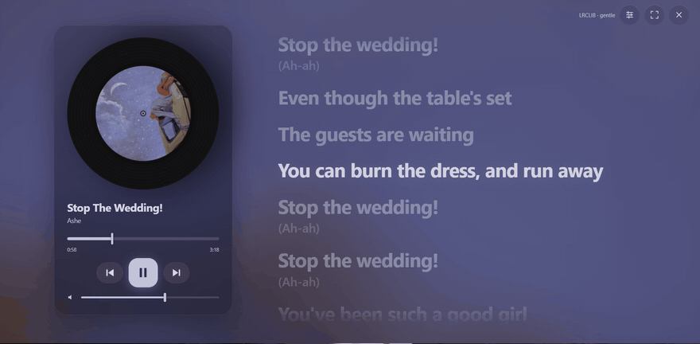
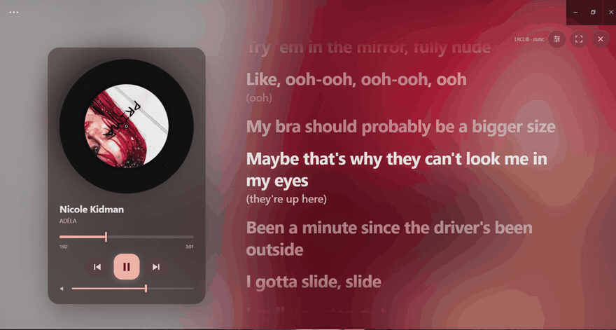
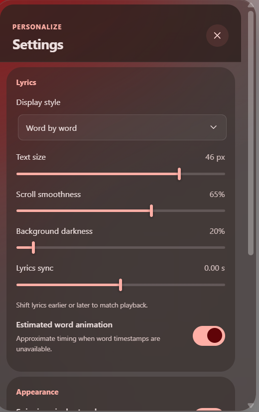

<div align="center>

# Luma Lyrics

A synced lyrics experience for Spotify desktop.

[Download](https://github.com/Altertone/Luma-Lyrics/releases/latest) · [Settings](#settings) · [Issues](https://github.com/Altertone/Luma-Lyrics/issues)



</div>

## Lyrics, your way

<table>
  <tr>
    <td width="50%" align="center">
      <strong>Word by word</strong><br>
      
    </td>
    <td width="50%" align="center">
      <strong>Line by line</strong><br>
      
    </td>
  </tr>
  <tr>
    <td width="50%" align="center">
      <strong>Gentle</strong><br>
      
    </td>
    <td width="50%" align="center">
      <strong>Static</strong><br>
      
    </td>
  </tr>
</table>

## Install

1. Download [luma-lyrics.js](https://github.com/Altertone/Luma-Lyrics/releases/latest).
2. Move it into your Spicetify Extensions folder.
3. Run:

   ```bash
   spicetify config extensions luma-lyrics.js
   spicetify apply
   ```

## Settings

<p align="center">
  
</p>

---

Lyrics are matched through [LRCLIB](https://lrclib.net). Settings are stored locally.  
[MIT License](LICENSE) · [Spicetify](https://spicetify.app)
