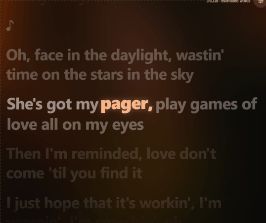
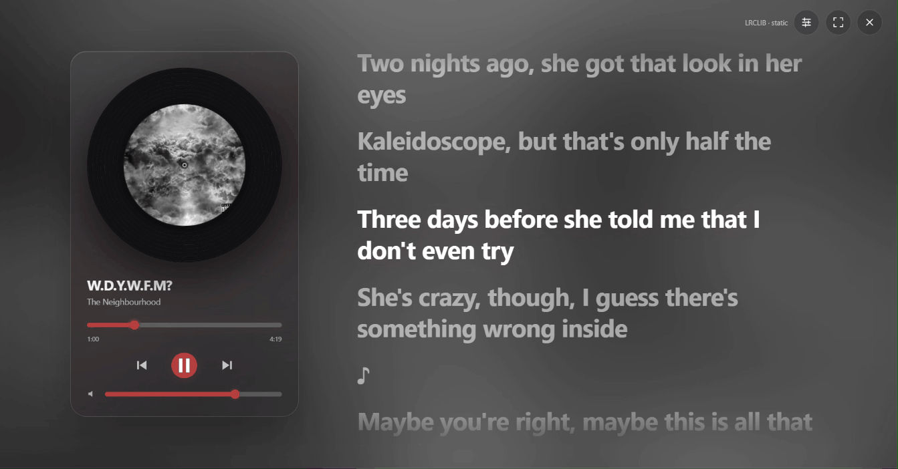
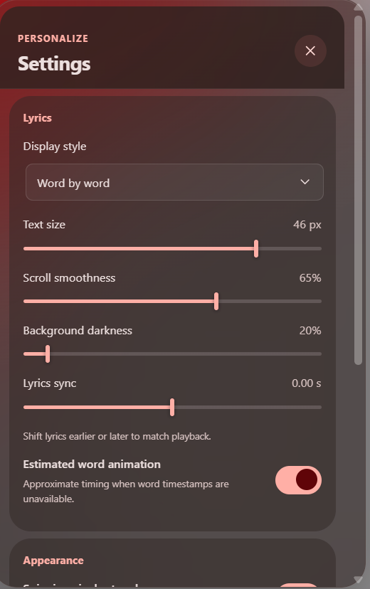

<div align="center">

<h1>Luma Lyrics</h1>

<p><strong>Know every word. Feel every beat.</strong></p>
<p>Spotify desktop, but with lyrics that actually keep up.</p>

<p>
  <a href="CHANGELOG.md"></a>
  <a href="LICENSE"></a>
  <a href="https://spicetify.app"></a>
</p>

<p><a href="https://github.com/Shahisha1/Luma-Lyrics/releases/latest"><strong>Download</strong></a> · <a href="https://github.com/Shahisha1/Luma-Lyrics/issues">Report a problem</a></p>



</div>

## Why people like it

- Catch the right word at the right time with synced lyrics.
- Switch between word-by-word, line-by-line, gentle, and static modes.
- Let the album art set the color mood with Material You-inspired styling.
- Use the built-in player controls without leaving the lyric view.
- No manual lyric hunting — Luma Lyrics looks up tracks automatically.

## Modes

### Word by word


### Line by line


### Gentle


### Static



### Settings

<p align="center">
  
</p>

## Install

1. Download `luma-lyrics.js` from the [latest release](https://github.com/Shahisha1/Luma-Lyrics/releases/latest).
2. Copy it to your Spicetify extensions folder. On Windows, that is `%APPDATA%\spicetify\Extensions`.
3. Run:

   ```bash
   spicetify config extensions luma-lyrics.js
   spicetify apply
   ```

4. Open Spotify and click the Luma Lyrics button beside the playback controls.

## How lyric sync works

Luma Lyrics pulls lyrics from [LRCLIB](https://lrclib.net) and tries the best match available for the current track:

1. Real word timing when the source provides valid synced word data.
2. Line-timed lyrics when word timing is not available.
3. Estimated word animation for line-timed songs if enabled in settings.

If a lookup fails due to a network issue, timeout, or rate limit, reopen Luma Lyrics or change tracks and try again.

## Privacy

- Luma Lyrics sends the song title, artist, album, and duration to LRCLIB.
- It does not send your Spotify token to LRCLIB.
- Appearance settings are saved locally in Spotify on your device.

## Troubleshooting

Spotify or Spicetify updates and other themes may affect the extension. If something feels off, open an [issue](https://github.com/Shahisha1/Luma-Lyrics/issues) with your Spotify and Spicetify versions.

## Credits

- [Liquid Lyrics](https://github.com/NMWplays/Liquid-Lyrics) — inspiration for the lyric experience and smooth word-by-word flow.
- [LRCLIB](https://lrclib.net) — lyric lookup service used by the extension.
- [Spicetify](https://spicetify.app) — platform Luma Lyrics runs on.

## License

Luma Lyrics is available under the [MIT License](LICENSE). Lyrics, album artwork, and third-party services remain subject to their respective owners' terms.

Luma Lyrics is not affiliated with Spotify, Spicetify, or LRCLIB.
